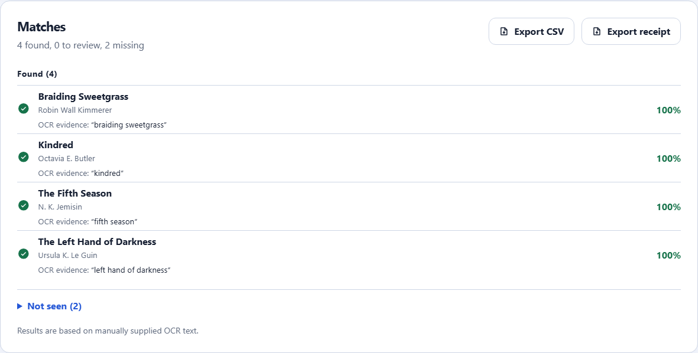
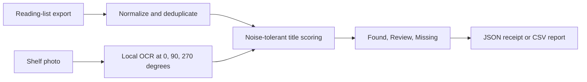

# TBRadar

[](https://github.com/KanadeK/tbradar/actions/workflows/ci.yml)
[](https://github.com/KanadeK/tbradar/actions/workflows/pages.yml)
[](LICENSE)

**Find the books you already want inside a crowded shelf photo. The photo never leaves your browser.**

[Try TBRadar](https://kanadek.github.io/tbradar/) · [中文说明](README.zh-CN.md) · [Acceptance guide](docs/acceptance.md) · [Research notes](docs/research.md)



## Why this exists

Book-spine scanners usually try to catalog every title or recommend something new. TBRadar starts with a narrower question that comes up in used bookstores, library sales, and home shelves:

> Which books in front of me are already on my to-be-read list?

Import a Goodreads, StoryGraph, or ordinary CSV export, take one shelf photo, and TBRadar ranks each wanted title as **Found**, **Review**, or **Missing**. Every decision includes the matching OCR text and confidence score, so a fuzzy scan is inspectable instead of magical.

## What works today

- Imports Goodreads and StoryGraph exports, generic CSV files, or one-title-per-line text.
- Filters recognized shelf/status columns to to-read, want-to-read, TBR, wishlist, or unread rows.
- Runs real Tesseract.js OCR in the browser. Shelf mode checks 0°, 90°, and 270° views for vertical spines.
- Matches noisy OCR with character similarity, token coverage, token precision, and an author-surname bonus.
- Lets the user edit OCR text and tune the confidence threshold before accepting results.
- Exports a versioned JSON scan receipt or a compact CSV report.
- Restores the reading list, OCR text, and threshold from local storage. The image itself is never persisted.
- Installs as a PWA and precaches the app shell plus the pinned OCR worker, compatible WASM cores, and English model.

There is no server, account, telemetry, recommendation API, or hidden demo response.

## Try it locally

Requirements: Node.js 24+ and npm 11+.

```bash
git clone https://github.com/KanadeK/tbradar.git
cd tbradar
npm ci
npm run dev
```

Open `http://127.0.0.1:5173`, choose **Try sample**, then **Scan shelf**. The synthetic shelf travels through the same Tesseract.js path as a user photo.

The roughly 15 MB OCR runtime bundle is versioned in this repository and served from the same origin as the app. No third-party runtime CDN is needed. After the PWA finishes precaching, recognition can work offline. See [the privacy model](docs/privacy.md) and [third-party notices](THIRD_PARTY_NOTICES.md).

## Input formats

| Source         | Recognized fields                                       | Behavior                                                         |
| -------------- | ------------------------------------------------------- | ---------------------------------------------------------------- |
| Goodreads CSV  | `Title`, `Author`, `Exclusive Shelf` or `Bookshelves`   | Keeps wanted/unread rows when a recognized shelf value exists    |
| StoryGraph CSV | `Title`, `Authors`, `Read Status`                       | Keeps to-read/unread rows when a recognized status exists        |
| Generic CSV    | `Title` or `Book Title`; optional `Author` and `Status` | Imports valid titles and applies the same optional status filter |
| Pasted text    | `Title`, `Title \| Author`, or `Title - Author`         | One book per line; duplicates are removed                        |

The parser removes a UTF-8 BOM, reports malformed rows, ignores empty titles, and assigns stable local IDs. Example inputs live in [`public/examples`](public/examples).

## How matching works



For each title, the matcher considers OCR lines, adjacent-line pairs, and title-sized token windows. The default **Found** threshold is 0.72. Scores down to 0.58 are surfaced for manual review; lower scores remain missing. Short titles receive an ambiguity penalty. The algorithm and its edge cases are unit-tested in [`src/core/matcher.test.ts`](src/core/matcher.test.ts).

## Verification

Install the pinned browser once:

```bash
node node_modules/@playwright/test/cli.js install chromium
```

Then run:

```bash
npm run verify          # static, format, lint, type, coverage, build, workflow E2E
npm run test:e2e:ocr   # real OCR against the synthetic shelf
npm run package        # versioned web ZIP and SHA256SUMS
npm run package:verify # byte-identical ZIPs across separated builds
```

The final, clean-worktree gate is:

```bash
npm run release:check
```

Expected evidence, common failures, and exact repair commands are in [docs/acceptance.md](docs/acceptance.md).

## Architecture

| Area                                                 | Responsibility                                                    |
| ---------------------------------------------------- | ----------------------------------------------------------------- |
| [`src/core/csv.ts`](src/core/csv.ts)                 | Source detection, status filtering, normalization, stable IDs     |
| [`src/core/ocr.ts`](src/core/ocr.ts)                 | Image preparation, rotation, Tesseract worker lifecycle, progress |
| [`src/core/matcher.ts`](src/core/matcher.ts)         | Pure candidate generation, scoring, classification, summary       |
| [`src/core/export.ts`](src/core/export.ts)           | Versioned JSON receipt and escaped CSV output                     |
| [`src/core/persistence.ts`](src/core/persistence.ts) | Small, recoverable local browser session                          |
| [`src/App.tsx`](src/App.tsx)                         | Accessible workflow and explicit error/review states              |

Read [docs/architecture.md](docs/architecture.md) for boundaries and design decisions.

## Known limits

- OCR quality still depends on focus, lighting, glare, spine size, and typography. Review is a first-class result, not a failure state.
- The bundled OCR configuration recognizes English text. Unicode titles can be imported and matched when OCR returns them, but additional language models are not yet exposed in the UI.
- TBRadar recognizes printed title text; it does not infer an edition from cover art or a barcode.
- A very wide shelf may work better as two or three closer photos.
- Browser storage is convenient, not a backup. Export a receipt when the result matters.

## Contributing and security

Small adapters, synthetic regression shelves, accessibility fixes, and documented OCR edge cases are welcome. Start with [CONTRIBUTING.md](CONTRIBUTING.md). Please report vulnerabilities privately as described in [SECURITY.md](SECURITY.md), especially anything that could cause a local image to leave the browser.

## License

[MIT](LICENSE) © 2026 KanadeK. The generated hero asset has separate provenance notes in [docs/asset-provenance.md](docs/asset-provenance.md).
