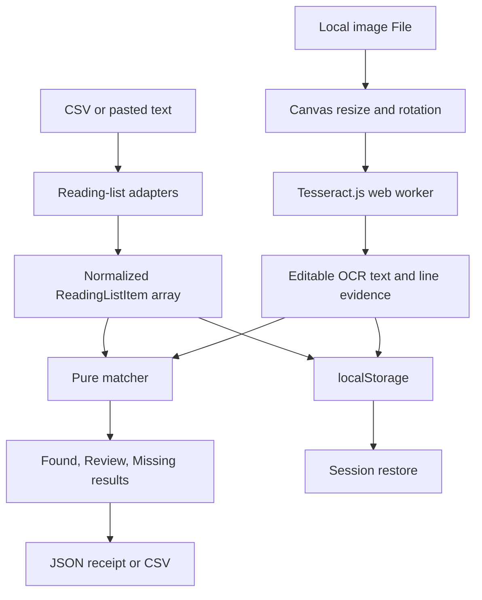

# Architecture

TBRadar is a static React application with a deliberately small trusted surface. Browser APIs handle files and storage; Tesseract.js handles OCR; pure TypeScript handles every import, match, summary, and export decision.

## Data flow



The image `File` is held in React state only. Persistence stores the normalized reading list, editable OCR text, and confidence threshold. Export records image metadata but never embeds pixels.

## Module boundaries

### `src/core/csv.ts`

- Normalizes headers independently from display text.
- Detects Goodreads and StoryGraph by characteristic columns.
- Applies wanted-status filtering only when at least one recognized wanted value is present. This avoids silently dropping all rows from an unfamiliar generic CSV.
- Produces deterministic FNV-1a IDs from normalized title and author values.
- Deduplicates repeated title-author pairs while preserving the first source row.

### `src/core/ocr.ts`

- Owns the single reusable Tesseract worker.
- Resizes small inputs up to an OCR-friendly target while capping very large inputs.
- Converts every orientation to a high-quality JPEG canvas before recognition.
- Quick mode recognizes 0°; shelf mode recognizes 0°, 90°, and 270°.
- Requests text and blocks, then flattens available line evidence without relying on it for correctness.
- Reports worker and orientation progress to the UI.

No upload or external request API is present in the application code. The worker, three compatible LSTM Core builds, and English model are pinned under `public/vendor/tesseract`, served from the app origin, and verified against locked package bytes. See [privacy.md](privacy.md).

### `src/core/matcher.ts`

The matcher is pure and deterministic. It normalizes Unicode with NFKD, removes combining marks, folds punctuation and whitespace, and ignores a leading English article when comparing titles.

For each title, candidates are generated from:

- individual OCR lines;
- adjacent OCR-line pairs;
- sliding token windows near the target title's token count.

The score is clamped to `[0, 1]`:

```text
0.56 × character similarity
+ 0.32 × title-token coverage
+ 0.12 × candidate-token precision
+ 0.04 author-surname bonus when present anywhere in OCR
- 0.18 ambiguity penalty for titles shorter than four compact characters
```

At the default threshold `0.72`, scores at or above the threshold are **Found**. Scores within `0.14` below it, with a floor of `0.42`, are **Review**. Everything else is **Missing**. Tests cover punctuation, articles, OCR substitutions, vertical text concatenation, ambiguous short titles, duplicate rows, and threshold boundaries.

### `src/core/export.ts`

The JSON receipt has an explicit `schemaVersion: 1`, application version, generation time, threshold, non-pixel image metadata, OCR orientations and duration, summary, and per-title evidence. CSV output follows RFC-style quote escaping for commas, quotes, and line breaks.

### `src/core/persistence.ts`

One versioned local-storage key, `tbradar.session.v1`, contains only the fields required to restore work. Invalid JSON, unavailable storage, and quota failures degrade to an empty or unsaved session instead of breaking the scanner.

## Error model

Errors are actionable and remain near the step that caused them:

- Import failures include missing headers and malformed CSV rows.
- Scan refuses to start without both a reading list and an image.
- OCR exceptions expose a retry message and preserve existing imported data.
- Review results keep their evidence visible instead of being rounded into a false binary answer.
- Export works from manually corrected OCR even if the original OCR result is unavailable.

## Build and release boundaries

- Vite produces a static PWA in `dist/`.
- GitHub Pages builds with `/tbradar/` as its base path; local and release builds use `/`.
- `scripts/package-release.mjs` sorts entries and fixes ZIP metadata before creating a versioned archive.
- `scripts/check-determinism.mjs` builds twice 1.2 seconds apart, compares bytes, and inspects required archive entries.
- `scripts/release-check.mjs` refuses an uncommitted worktree or co-author trailer, then executes the full browser, audit, and package gate.

## Change rules

1. Source adapters stay independent of React so fixtures remain cheap.
2. A matcher change requires a regression test with the OCR fragment that motivated it.
3. A new network destination requires a privacy-document update and explicit UI disclosure.
4. A sample must exercise production code; fixed success data is not accepted.
5. Export schema changes require a schema-version change and backward-compatibility note.
